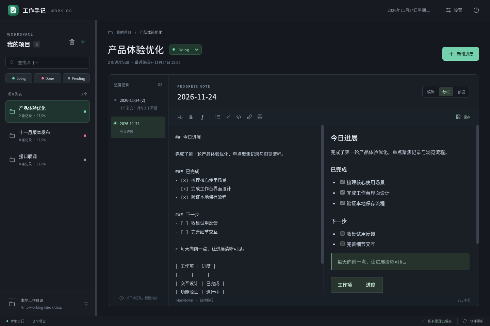

# 工作手记 · Worklog

本地运行的日常工作进度记录工具。启动 Go 程序后自动打开浏览器，项目、Markdown 记录和图片保存在自己选择的文件夹中。

在 [Releases](https://github.com/UMR731x/worklog/releases) 下载 `windows-x86_64.exe`、`linux-x86_64.bin` 或源码 ZIP。Linux 下载后先运行 `chmod +x linux-x86_64.bin`，再运行 `./linux-x86_64.bin`。



## 使用

- **Windows x64**：双击 `worklog.exe`，浏览器会自动打开。程序无需安装 Go、Node.js 或数据库。
- **Linux x64**：运行 `./worklog`，通过系统的 `xdg-open` 打开默认浏览器；也可以访问终端打印的本机地址。
- 程序目录需可写，首次启动会在可执行文件旁创建 `data/`。在「设置」中可浏览文件夹或填写完整路径，切换工作目录。
- 启动后显示系统托盘图标，点击图标或选择菜单中的「打开工作手记」可重新打开页面；右键菜单中的「彻底退出」会关闭后台服务并移除托盘图标。
- 页面右上角的电源按钮会先保存编辑再退出。托盘退出前请确认状态栏显示已保存；关闭浏览器标签页会保留后台程序运行。Linux 终端也可按 `Ctrl+C` 退出。

程序只监听 `127.0.0.1`，端口由操作系统分配。前端资源已嵌入可执行文件，项目编辑可离线使用。Linux 托盘需要桌面支持 StatusNotifierItem / AppIndicator；GNOME 可能需要启用对应的托盘扩展。Windows 图标可能收纳在任务栏的隐藏图标区域。

## 功能

- 项目创建、查找、删除，侧栏宽度可拖动调整。
- Doing 绿色、Done 红色、Pending 灰色状态灯，支持同时筛选多个状态。
- 按日期新增进度，同日多条自动命名为 `2026-11-24`、`2026-11-24 (2)` 等。
- Markdown 编辑、分栏和预览，支持任务列表、表格、代码块及图片。
- 图片可以选择文件、粘贴或拖入编辑区，保存到对应项目的 `sources/`。
- 停止输入 600 毫秒后自动保存，也可点击「保存」或按 `Ctrl+S` / `Cmd+S`。
- 切换项目、记录或工作目录前等待保存。保存失败时保留当前编辑，提示错误；关闭有未保存内容的标签页时，浏览器会提示确认。
- 工作目录切换后展示新目录内容，原数据保持原位；目录选择在下次启动时恢复。
- 在设置中选择日间、夜间或跟随系统。主题立即生效，保存在程序目录的 `settings.json` 中；重启、更换端口或切换工作目录后仍然保留。
- 新图标用于页面、浏览器标签、系统托盘及 Windows 可执行文件。

## 软件更新

右下角「软件更新」每天首次启动时自动检查 [GitHub 正式 Release](https://github.com/UMR731x/worklog/releases/latest)，也可手动检查。检查请求最多等待 15 秒，失败会显示在更新窗口中，正常编辑不受影响。检查日期缓存在程序目录的 `.worklog-update.json`。

发现新版本后，点击「下载并更新」：先保存当前编辑，再下载当前平台的 `windows-x86_64.exe` 或 `linux-x86_64.bin`，替换当前程序、重启并删除旧程序文件。更新保留项目、图片、主题和目录设置。下载失败或替换失败时保留或恢复当前程序；安装期间请保持页面打开。

本地构建默认版本为 `v0.2.0-dev`。更新只安装版本号更高的正式版，不会降级；测试版可以升级到同版本号的正式版，例如从 `v0.2.0-dev` 升级至 `v0.2.0`。

## 数据保存

按已确认的方案采用 **每项目一个 JSON**。第一版适用于个人本机记录，不引入数据库服务、账号或云同步。同一工作目录应由一个程序实例使用；当前没有跨进程、跨设备的编辑冲突合并。

```text
worklog.exe
settings.json                  # 保存所选目录和主题
.worklog-update.json            # 软件更新检查缓存
data/
  <项目 ID>/
    project.json
    sources/
      <图片 ID>.png
```

项目名保存在 JSON 中，目录使用独立 ID，因此中文、空格及项目名中的 `/` 等字符不会变成文件路径。

```json
{
  "name": "产品体验优化",
  "status": "Doing",
  "entries": {
    "2026-11-24": "## 今日进展\n完成工作台设计。\n\n",
    "2026-11-24 (2)": "下午补充接口联调记录。"
  }
}
```

保存 JSON 时先写入同目录的临时文件并刷新，再替换原文件，以减少直接截断旧文件造成的数据丢失。异常 JSON 会显示读取提示，原文件保留，其他项目仍可使用。应用不会自动修复或覆盖损坏的项目。

备份时退出程序并复制整个工作目录。迁移单个项目时复制完整的项目 ID 文件夹，包含 JSON 和 `sources/`。如果修改 `settings.json`，其中的相对路径以可执行文件所在目录为基准；设置界面保存的是完整路径。

## 从源码构建

需要 **Go 1.25 或更新版本**。首次构建下载锁定版本的 Markdown、托盘及版本比较依赖，无需前端构建工具、C 编译器或额外数据库依赖。

Linux / macOS 构建机：

```sh
sh build.sh
```

Windows PowerShell：

```powershell
.\build.ps1
```

两个脚本均生成：

```text
dist/windows-amd64/worklog.exe
dist/linux-amd64/worklog
```

Windows 使用 GUI 子系统构建，双击不会附带控制台窗口；启动失败时显示错误对话框。需要终端输出调试时，可以自行运行 `go build -buildvcs=false -o worklog.exe .`。

发布时，在 `docs/releases/<版本标签>.md` 编写说明，再推送 `v` 开头的版本标签。GitHub Actions 会把标签通过 `VERSION` 写入程序，从该标签构建并发布两个可执行文件，GitHub 自动提供对应的源码 ZIP。测试代码只推送分支，不推送版本标签。

图标源文件为 `web/icon.svg`，托盘使用 `web/icon.png`，Windows 多尺寸图标为 `assets/worklog.ico`。`resources_windows_amd64.syso` 是图标生成的 Windows 资源，可用 `go run github.com/akavel/rsrc@v0.10.2 -arch amd64 -ico assets/worklog.ico -o resources_windows_amd64.syso` 重新生成。

开发时建议先编译再运行，使数据稳定保存在所构建程序旁。`go run .` 的可执行文件位于 Go 的临时目录，不适合保存实际工作记录。

## 验证

```sh
go test -buildvcs=false ./internal/workspace ./internal/server ./internal/update
go vet -buildvcs=false ./...
```

自动化用例覆盖记录持久化、同日条目不覆盖、目录切换后的迟到写入、图片读写与删除、异常 JSON 隔离、HTTP 编辑流程、Markdown 渲染和本机服务的浏览器访问边界。

已在 Linux 下使用 Chromium 验证项目编辑、三种主题、系统主题变化、主题重启恢复、真实 GitHub 更新检查及更新失败后的编辑恢复；使用隔离 D-Bus 托盘宿主验证图标、菜单和完整退出。更新测试覆盖每日检查缓存、开发版不降级、损坏下载、替换回退，以及实际子进程重启和旧文件删除。Windows 版本完成交叉编译；Windows 托盘及自更新的实机表现待测试。

## 代码结构

- `main.go`：程序启动、本机 HTTP 服务、退出流程。
- `internal/workspace/`：项目 JSON、图片、工作目录和设置的持久化。
- `internal/server/`：HTTP 接口、Markdown 渲染和静态资源。
- `internal/platform/`：Windows / Linux 的浏览器打开和错误提示。
- `internal/platform/tray.go`：系统托盘图标、打开和退出菜单。
- `internal/update/`：正式版本检查、下载、程序替换及重启交接。
- `web/`：无需构建的 HTML、CSS、JavaScript，由 Go 内嵌。

原始需求中的 MyGo 桌面框架已按确认方案调整为 Go 本地服务与外部浏览器；数据仍按 JSON 项目目录组织。Markdown 渲染使用 [goldmark](https://github.com/yuin/goldmark)，其 MIT 许可见 [THIRD_PARTY_NOTICES.md](THIRD_PARTY_NOTICES.md)。
