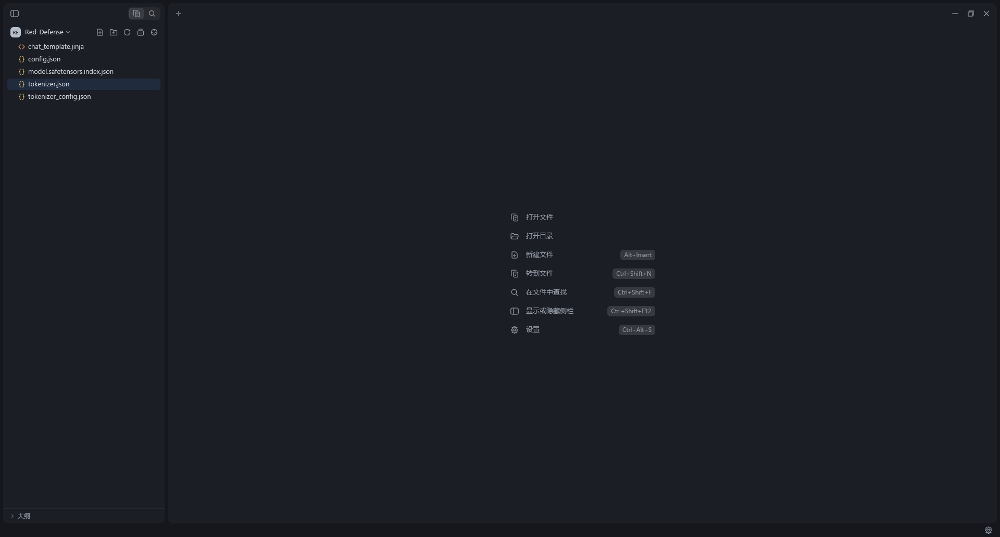

# 开发一个日常工作进度记录软件

## 平台及语言要求：
- windows & Linux 平台，MyGO框架，GO语言

## 功能需求

### 前端
- webUI，软件启动后，监听某端口，打开浏览器看前端
- 左侧边栏，类似VSCODE那种边栏，可以显示各类工作项，比如我一共有A B C三个工作，那么左侧边栏就显示A B C三个项目。同时允许在左边栏新建项目，表示新的工作项。左侧边栏类似这样
    
  当然这个是简化版，只是说明是这个形状。
- 左侧栏的项目，在项目名后面需要跟一个类似红绿灯的圆灯，绿色表示Doing，红色表示Done，灰色表示Pending。当前就这三个状态。
- 左侧栏还有分类功能。在左侧栏的最上面一栏，设计为功能区，能够按照三种状态（Doing Done Pending)分别分类显示当前每一种状态下的工作项。可以选中多个状态，也可以只显示某一种状态的。同时功能区有`新增项目`的功能、有`删除项目`的功能，有`查找项目`的功能。
- 左侧栏和中间的分界线可以拖拽，来更改左侧栏和中间区的大小。
- 中间大编辑页面，需要左侧栏中选中任意一个项目，然后开始编辑。编辑页面主要区域允许用户新增工作进度条目，条目默认命名为当前日期格式，比如用户在A项目下新增一个任务条目，这个条目就命名为`2026-11-24`
  用户可以在这个条目的编辑区中进行编辑，说明当前工作进度。
- 中间页面上方显示当前项目的名称，并且可以有按钮修改项目状态，可以任意改为Doing Done 或者 Pending。
- 编辑区自动换行，markdown格式，允许插入图片。
- 整个的最上面一行是菜单栏，放一些系统设置之类。

### 后端
- 软件使用json保存数据。每个工作项单独建立一个目录，新建工作项的时候建立这个目录，删除工作项的时候删除这个目录。json文件保存在这个工作项的目录中，图片资源保存在这个目录的sources子目录，在json中引用；
- 新增的工作进度条目在json中表示为一个新的key，value即这个工作进度的内容，用string保存。
- 工作项的三个状态，在json中表示为"status"字段。
- 数据目录就放在软件的当前目录下，也允许用户改目录，可以在设置中选择工作目录，选择后页面会更改到新的目录中，显示的也是新的目录的内容。
- windows端打包成.exe文件，可以直接启动运行。

## 风格要求
- 现代化UI风格、灵动而不复杂，整体协调美观。